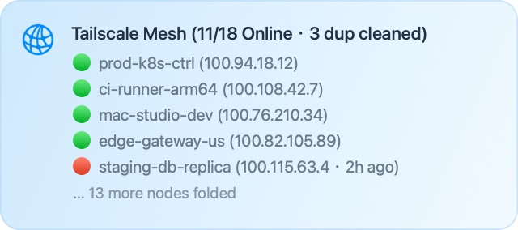

<div align="center">

# Surge Tailscale Mesh Status Panel (`surge-tailscale-panel`)

<p>Real-time <strong>Tailscale Mesh VPN topology monitor &amp; ephemeral ghost-node garbage collector</strong> for <strong>Surge macOS &amp; Surge iOS</strong>, engineered for DevOps, homelab, and multi-cloud infrastructure workflows.</p>

<p>
  
  
  
</p>

<p>
  
</p>

</div>

---

## 🎯 Why This Exists (DevOps & Mesh Topology Pain Points)

When managing a distributed **Tailscale** mesh across workstations, CI runners, cloud sandboxes, and mobile endpoints alongside **Surge**, infrastructure operators routinely hit three operational friction points:

1. **Ephemeral Re-Handshake Ghost Sprawl (`-1`, `-2`, …)**: Whenever an embedded mesh client or ephemeral container re-authenticates with the Tailscale control plane, stale offline registrations with incrementing numeric suffixes (`mac-mini-1`, `mac-mini-2`, …, `mac-mini-13`) accumulate in the device inventory—obscuring genuine node outages.
2. **Dashboard Viewport Clutter**: A 20-to-40-node mesh stretches mobile and desktop network dashboards beyond a single screen, burying critical production nodes under historical offline records.
3. **JavaScriptCore Runtime Incompatibilities**: Many community scripts rely on browser-only DOM APIs (`URLSearchParams`, `btoa`) or naive timestamp heuristics that throw `ReferenceError` in Surge's native **JavaScriptCore** engine or trigger false-positive node deletions.

`surge-tailscale-panel` solves all three directly inside your Surge dashboard—with zero external dependencies.

---

## ✨ Key Engineering Features

- **Native JavaScriptCore (ES5) Architecture**: Written in strict, zero-dependency ES5 using `Object.create(null)` (preventing prototype pollution on arbitrary hostnames), `try/catch`-guarded URI decoding/encoding, and a top-level `safeRun` exception boundary. Authenticates with Tailscale API v2 via standard `Bearer` tokens.
- **Strict 3-State Control-Plane Online Detection**: Evaluates online reachability strictly from explicit boolean control-plane fields (`connectedToControl` / `online` via `?fields=all`), rendering `🟢` (online), `🔴` (offline), or `⚪` (`state unknown` if boolean fields are absent). Never guesses online state from `lastSeen` timestamps.
- **4-Tuple Composite Grouping + 5-Attribute Identity Guard (`HIDE_DUP`)**: Groups candidate ghost nodes by `base | hostname | os | user` only after verifying all five identity attributes (`id`, `name`, `hostname`, `os`, `user`), an explicit boolean online state, and Tailscale's auto-numbering invariant (`hostname === base` with at least one `-N` suffixed sibling)—ensuring legitimate numbered production hosts (`db-1`, `db-2`) are never misclassified.
- **Guarded Cloud Garbage Collection (`CLEAN_DUP` & `MIN_OFFLINE_HOURS`)**: Safely disabled (`false`) by default. When explicitly enabled (`true`), calls `DELETE /api/v2/device/{id}` (capped at 10 deletions per poll) only for verified duplicate ghost nodes that have been offline for at least `MIN_OFFLINE_HOURS` (default `24` hours) and are **not** protected (`isExternal`, ACL `tags`, or `keyExpiryDisabled`).
- **Viewport-Aware Node Folding (`MAX_VISIBLE`)**: Customize how many device rows are rendered before folding (`1`–`5`, default `5`; when overflow occurs, 1 additional summary footer line is appended). Active online nodes are prioritized at the top, and the header counter reflects active and visible/retained nodes after duplicate filtering.

---

## 📦 Repository Contents

| File / Path | Description |
| :--- | :--- |
| [`tailscale-panel.js`](./tailscale-panel.js) | Standalone Surge panel script (ES5 / JavaScriptCore compatible, v1.3.0). |
| [`Tailscale-Panel.sgmodule`](./Tailscale-Panel.sgmodule) | Surge module definition (`[Panel]` + `[Script]`, `update-interval=300`, `timeout=20`). |
| [`assets/preview.png`](./assets/preview.png) | Synthetic Retina (`@2x`) UI preview image showing DevOps sample nodes. |
| [`.gitignore`](./.gitignore) | Git ignore rules for local build artifacts and OS metadata. |
| [`README.md`](./README.md) | Architecture, parameter reference, and DIY setup documentation. |
| [`LICENSE`](./LICENSE) | MIT License. |

---

## ⚙️ Script & Module Arguments Reference

`tailscale-panel.js` reads its configuration from Surge's `$argument` query string (`tailnet={{{TAILNET}}}&apikey={{{API_KEY}}}&max_visible={{{MAX_VISIBLE}}}&hide_dup={{{HIDE_DUP}}}&clean_dup={{{CLEAN_DUP}}}&dry_run={{{DRY_RUN}}}&min_offline_hours={{{MIN_OFFLINE_HOURS}}}`):

| Module Argument (`#!arguments`) | Script `$argument` Key | Default | Description |
| :--- | :--- | :--- | :--- |
| `TAILNET` | `tailnet` | `-` | Tailnet organization identifier. Keep `-` to automatically target the default tailnet of the authenticated token. |
| `API_KEY` | `apikey` | `tskey-api-xxx` | **Required.** Your Tailscale API access token (`tskey-api-...`) or OAuth access token. |
| `MAX_VISIBLE` | `max_visible` | `5` | Maximum number of device rows displayed before folding (`1`–`5`, automatically clamped; adds 1 summary footer line when overflow nodes are folded). |
| `HIDE_DUP` | `hide_dup` | `true` | Hide stale duplicate offline ghost nodes (`-1`, `-2`, …) in the panel display (`true` / `false`). Note: nodes eligible for `CLEAN_DUP` are also hidden from the active list. |
| `CLEAN_DUP` | `clean_dup` | `false` | Automatically invoke `DELETE /api/v2/device/{id}` to purge verified stale duplicate offline ghost nodes from your Tailnet (`true` / `false`). Disabled by default. |
| `DRY_RUN` | `dry_run` | `false` | Preview eligible ghost nodes and their offline age in the panel footer without executing cloud `DELETE` requests (`true` / `false`). Always overrides `CLEAN_DUP`. |
| `MIN_OFFLINE_HOURS` | `min_offline_hours` | `24` | Minimum offline age in hours (`1`–`720`, default `24`) required before `CLEAN_DUP` is allowed to delete a duplicate offline ghost node from Tailscale Cloud. |
| `SCRIPT_PATH` | *(Surge directive)* | `tailscale-panel.js` | Local file path (in Surge `Documents/` directory) or a pinned `https://` Raw URL to `tailscale-panel.js`. |

*(Note: The `[Panel]` refresh interval defaults to `update-interval=300` seconds in [`Tailscale-Panel.sgmodule`](./Tailscale-Panel.sgmodule), and the `[Script]` execution timeout is set to `timeout=20` seconds to comfortably accommodate the `6s` `GET` + `6s` `DELETE` network budget.)*

---

## 📊 Community vs. Pro Edition

**Community Edition** (this repository) is a complete, uncrippled topology monitor and guarded ghost-node garbage collector. **Pro Edition** is built for engineers running unattended remote infrastructure who want background state-transition notifications, machine-key expiration alerts, and fleet version telemetry.

| Capability | Community (MIT) | Pro Edition |
| :--- | :---: | :---: |
| Real-time topology & 3-state status panel (`🟢` / `🔴` / `⚪`) | ✅ | ✅ |
| `HIDE_DUP` (4-tuple composite grouping + 5-attribute identity guard) | ✅ | ✅ |
| `CLEAN_DUP` ephemeral ghost-node GC (4-layer safety guards) | ✅ | ✅ |
| `DRY_RUN` interactive candidate preview before any cloud `DELETE` | ✅ | ✅ |
| Unattended background `type=cron` monitor (`*/10 * * * *`) | — | ✅ |
| Stateful `Online <-> Offline` push alerts (`WATCH_NODES` + 2-poll debounce) | — | ✅ |
| Machine key expiry badges (`🔑 exp Nd`) + tiered pre-expiry alerts | — | ✅ |
| Client update drift indicator (`SHOW_UPDATES` `⬆️`) | — | ✅ |
| Offline-ready self-contained bundle + `PRO-SETUP-GUIDE.md` | — | ✅ |

👉 **[Get Tailscale Mesh Status Panel (Pro Edition) on Gumroad →](https://flylocus.gumroad.com/l/tailscale-panel-pro)** *(One-time purchase, no subscription or license server — funds ongoing maintenance and includes the self-contained Pro bundle & setup guide).*

---

## 🛠️ Manual Setup (Open-Source DIY)

> **Requirements:** Surge iOS 5.8+ or Surge macOS 5.4+ (with `#!arguments` module support).

### Option A: Local / iCloud Drive Surge Directory (Recommended)
1. Copy both [`Tailscale-Panel.sgmodule`](./Tailscale-Panel.sgmodule) and [`tailscale-panel.js`](./tailscale-panel.js) into your Surge configuration directory (e.g., `iCloud Drive/Surge/Documents/`).
2. In Surge **Modules**, enable **Tailscale Mesh Status Panel**, open **Edit Arguments**, and enter your `API_KEY` (leave `SCRIPT_PATH` as `tailscale-panel.js`).

### Option B: Remote Script URL
If installing `.sgmodule` without copying `tailscale-panel.js` locally, set `SCRIPT_PATH` to a commit-pinned HTTPS Raw URL (prefer pinning to a verified commit SHA or release tag rather than a mutable branch):
```text
https://raw.githubusercontent.com/flylocus/surge-tailscale-panel/main/tailscale-panel.js
```

---

## 🔑 Credential Security & Cloud Deletion Guards

> [!CAUTION]
> **Never commit, share, or publish a configured `.sgmodule` file, Surge profile, or debug log containing a live `API_KEY`.** If a credential is exposed, immediately revoke it in the [Tailscale Admin Console → Settings → Keys](https://login.tailscale.com/admin/settings/keys).

- **Unattended Dashboards (Default Recommendation): Personal API Access Tokens (`tskey-api-...`)**:
  - Generated under [Tailscale Admin Console → Settings → Keys](https://login.tailscale.com/admin/settings/keys) (1–90 days expiry). Because personal API tokens inherit the creator's role permissions without granular scopes, keep `CLEAN_DUP=false` (default) unless you intentionally want automated cloud ghost-node pruning.
- **Scoped Short-Lived Option: OAuth Clients / Trust Credentials (`devices:core:read`)**:
  - Supports granular scopes (**`devices:core:read`** for read-only mode; **`devices:core`** when `CLEAN_DUP=true`). Note that OAuth access tokens expire after 1 hour and require an external rotation job.
- **4-Layer Cloud Deletion Safety Guards (`CLEAN_DUP=true`)**:
  - Deleting a device permanently removes it from your Tailnet. A candidate offline node is only eligible for `DELETE /api/v2/device/{id}` when **all four** invariants hold:
    1. **5 Mandatory Attributes & Explicit Offline State**: The device object contains valid `id`, `name`, `hostname`, `os`, and `user` strings, an explicit offline boolean (`connectedToControl: false` / `online: false`), and a valid `lastSeen` timestamp (`> 0`).
    2. **4-Tuple Composite Group & Suffix Invariant**: Stripping the `-N` numeric suffix from the device short name equals its exact `hostname` (`base === hostname`), and multiple nodes share the identical `base | hostname | os | user` key with at least one `-N` suffixed member. *(Known limitation: hostnames containing spaces or apostrophes that Tailscale normalizes into hyphens in `name` will have `hostname !== base` and are safely skipped.)*
    3. **Newer Sibling Proof & Minimum Offline Age (`MIN_OFFLINE_HOURS`)**: Another sibling in the same group is explicitly online (`connectedToControl: true`) or holds a strictly newer `lastSeen` timestamp, **and** the candidate node has been offline for at least `MIN_OFFLINE_HOURS` (default `24h`, protecting distinct default-named hosts such as two `raspberrypi` nodes during brief reboots).
    4. **Protected Device Exclusion**: The device is **not** an external shared node (`isExternal !== true`), has **no** ACL `tags`, and does **not** have `keyExpiryDisabled === true`.

---

## 📄 License

Released under the [MIT License](./LICENSE).
