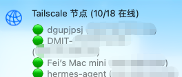

<div align="center">

# Surge Tailscale 节点状态面板 (`surge-tailscale-panel`)

<p>在 <strong>Surge iOS / Surge Mac</strong> 仪表盘实时显示 Tailscale 节点在线/离线状态的 <code>[Panel]</code> 模块，支持同名离线幽灵节点（<code>-1</code>、<code>-2</code>…）智能去重与可选云端自动清理。</p>

<p>
  <a href="./README.md"></a>
  <a href="./README.zh-CN.md"></a>
</p>

<p>
  
</p>

</div>

---

## ✨ 核心特性

- **原生 JavaScriptCore 零依赖兼容**：不依赖浏览器 DOM API（如 `URLSearchParams`、`btoa`），采用 Tailscale API v2 标准 `Bearer` 认证，内置安全参数解码（`try/catch` + `Object.create(null)` 防原型链污染）。
- **明确布尔状态判定在线**：严格依据 API（`?fields=all`）明确返回的布尔连接字段（`connectedToControl` / `online`）判定在线状态，绝不根据 `lastSeen` 时间推断在线。
- **同名离线幽灵节点面板去重 (`HIDE_DUP`)**：针对 Surge 原生 `[Tailscale]` 重新握手容易产生 `-1`、`-2` 等递增后缀离线残留节点的问题，脚本会自动识别具有相同基础名称、`hostname`、`os` 与 `user` 的旧离线节点并在面板中隐藏。
- **可选云端自动清理 (`CLEAN_DUP`)**：出于安全考虑**默认关闭 (`false`)**。显式开启（`true`）后，仅对具备完整身份字段（`id`、`name`、`hostname`、`os`、`user`）、明确离线布尔状态及合法 `lastSeen` 时间戳的旧重复离线节点调用 `DELETE /api/v2/device/{id}`，并在收到 HTTP 2xx 响应确认后在面板标题展示真实清理结果。
- **可见节点数自由控制 (`MAX_VISIBLE`)**：支持自定义面板展示的节点行数（`1`–`5` 个，默认 `5`），在线节点优先排列，超出部分自动折叠汇总，标题栏仍保留完整的 `在线数/总数` 统计。

---

## 📦 文件说明

| 文件 | 用途 |
| :--- | :--- |
| [`Tailscale-Panel.sgmodule`](./Tailscale-Panel.sgmodule) | Surge 模块定义文件（含 `[Panel]` 与 `[Script]`）。 |
| [`tailscale-panel.js`](./tailscale-panel.js) | 独立面板脚本源码（兼容 ES5 / Surge JavaScriptCore）。 |
| [`README.md`](./README.md) | 英文说明文档（默认首页）。 |
| [`README.zh-CN.md`](./README.zh-CN.md) | 简体中文说明文档。 |
| [`LICENSE`](./LICENSE) | MIT 开源协议。 |

---

## 🚀 安装方式

### 方式一：本地 / iCloud Drive 目录安装
1. 将 [`Tailscale-Panel.sgmodule`](./Tailscale-Panel.sgmodule) 与 [`tailscale-panel.js`](./tailscale-panel.js) 放入 Surge 配置根目录（如 `iCloud Drive/Surge/Documents/`）。
2. 在 Surge **模块** 中启用 **Tailscale 节点状态面板**，点击 **编辑参数** 填入你的 `API_KEY`（`SCRIPT_PATH` 保持默认的 `tailscale-panel.js`）。

### 方式二：远程 HTTP(S) Raw 链接订阅
Surge 会将相对路径 `script-path` 解析到本地配置目录。若仅通过远程链接安装 `.sgmodule` 而不把 `tailscale-panel.js` 放入本地目录，**必须**将模块参数 `SCRIPT_PATH`（或托管前直接修改 `Tailscale-Panel.sgmodule` 中的 `script-path`）设置为 `tailscale-panel.js` 的完整 HTTP(S) Raw URL：
```text
https://raw.githubusercontent.com/flylocus/surge-tailscale-panel/main/tailscale-panel.js
```

---

## ⚙️ 模块参数 (`#!arguments`)

| 参数名 | 默认值 | 说明 |
| :--- | :--- | :--- |
| `TAILNET` | `-` | Tailnet 组织名称，保持默认的 `-` 即可自动匹配当前 API 凭据所属账户。 |
| `API_KEY` | `tskey-api-xxx` | **必填**，你的 Tailscale API Access Token（`tskey-api-...`）或 OAuth / Trust Credential 令牌。 |
| `MAX_VISIBLE` | `5` | 面板最多显示的节点行数，取值范围 `1`–`5`（超出范围自动限制在 `1`–`5`，其余节点折叠显示）。 |
| `HIDE_DUP` | `true` | 是否在面板中隐藏同名的旧重复离线节点（`true` / `false`，默认 `true`，仅影响面板显示，不删除云端设备）。 |
| `CLEAN_DUP` | `false` | 是否自动调用 `DELETE /api/v2/device/{id}` 从 Tailnet 云端删除同名的旧重复离线节点（`true` / `false`，默认 `false`）。 |
| `SCRIPT_PATH` | `tailscale-panel.js` | 脚本路径（本地安装保持默认 `tailscale-panel.js`；远程订阅请填脚本的完整 `https://...` Raw URL）。 |

---

## 🔑 凭据权限与安全说明

> [!CAUTION]
> **严禁提交、分享或截图已填入真实 `API_KEY` 的 `.sgmodule` 模块配置、Surge 配置文件或请求日志。** 一旦令牌不慎泄露，请立即前往 [Tailscale Admin Console → Keys](https://login.tailscale.com/admin/settings/keys) 吊销并重新生成。

- **首选推荐（最小权限）：OAuth Client / Trust Credentials 令牌（`devices:core:read`）**：
  - 优先推荐使用支持细粒度 Scope 的令牌：保持默认 `CLEAN_DUP=false` 时仅授予只读权限 **`devices:core:read`**；仅在显式开启 `CLEAN_DUP=true` 时才授予 **`devices:core`**。注意 OAuth 签发的短期 access token 通常 1 小时后过期，本脚本不包含自动续期逻辑；长期面板使用请通过外部机制轮换或谨慎使用 API Access Token。
- **较高风险选项：个人 API Access Token（从 Admin Console → Keys 生成的 `tskey-api-...`）**：
  - 个人 API Access Token 继承创建者的完整账户角色权限，不支持细粒度 scope 划分。请保持默认 `CLEAN_DUP=false`（仅发起只读 `GET` 请求），并妥善保管密钥。
- **云端删除安全保护（`CLEAN_DUP=true`）**：
  - 从 Tailnet 删除设备会使该节点永久断开。脚本仅在候选节点同时满足以下全部条件时才会发起删除：
    1. 具备完整的 `id`、`name`、`hostname`、`os`、`user` 字段、明确的离线布尔状态（`connectedToControl: false` / `online: false`）以及合法的 `lastSeen` 时间戳；
    2. 与同组带 `-数字` 后缀的节点具有完全一致的基础名称、`hostname`、`os` 与 `user`；
    3. 该分组下已存在明确在线（`connectedToControl: true`）节点，或存在 `lastSeen` 时间戳严格更新的节点。

---

## 📄 开源协议

[MIT](./LICENSE)
